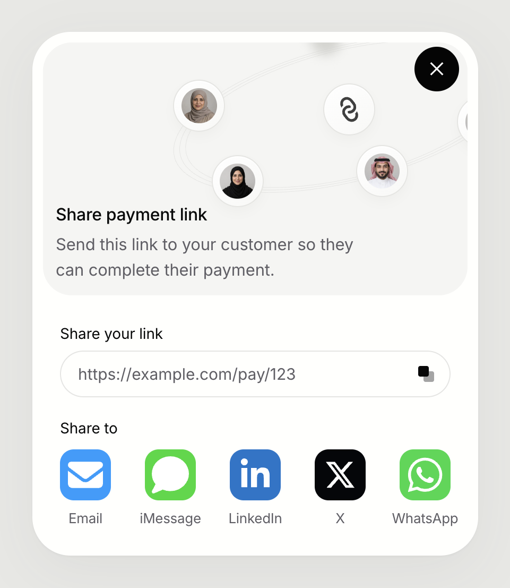

# Payment Link Modal

A compact React payment-link sharing modal with Saudi portrait artwork, a copyable link, and five sharing shortcuts. Includes reusable components and a Vite demo.



## Run locally

Requires Node.js 22 or later and npm.

```sh
git clone https://github.com/Haqbani/payment-link-modal.git
cd payment-link-modal
npm ci
npm run dev
```

To build and preview the production version:

```sh
npm run build
npm run preview
```

## Use in your app

Copy `src/components/payment-link-modal` into your React project and install `@fontsource/inter`. The component imports its scoped styles, font, and artwork.

```jsx
import { useState } from 'react';
import { PaymentLinkModal } from './components/payment-link-modal';

export default function PaymentPage() {
  const [open, setOpen] = useState(false);

  return (
    <>
      <button onClick={() => setOpen(true)}>Share payment link</button>
      <PaymentLinkModal
        open={open}
        onClose={() => setOpen(false)}
        paymentUrl="https://example.com/pay/123"
      />
    </>
  );
}
```

| Prop | Type | Purpose |
| --- | --- | --- |
| `open` | `boolean` | Controls whether the modal is open. |
| `onClose` | `() => void` | Called when the user dismisses the modal. |
| `paymentUrl` | `string` | The link to copy and share. Required. |

The same entry point also exports `CopyLinkField`, `ShareButtons`, and `ShareIllustration`. Both `CopyLinkField` and `ShareButtons` accept `paymentUrl` and an optional `label`; their default labels are “Share your link” and “Share to”.

## Behavior

- Native dialog with keyboard focus containment and Escape dismissal.
- Copy feedback and a selectable link; clipboard copying requires HTTPS or localhost.
- Email, iMessage, LinkedIn, X, and WhatsApp shortcuts. They open a composer and never send automatically. Email and messaging links require a compatible installed app; behavior varies by device.
- Responsive layout with a solid neutral background in the demo.

The component shares an existing URL; it does not create payment links or process payments.

## License

Code is [MIT licensed](LICENSE). The fictional Saudi portraits are AI-generated; included project rights are licensed under MIT to the extent copyright applies. Font Awesome icons and Inter use their own licenses. See [third-party notices](THIRD_PARTY_NOTICES.md).
